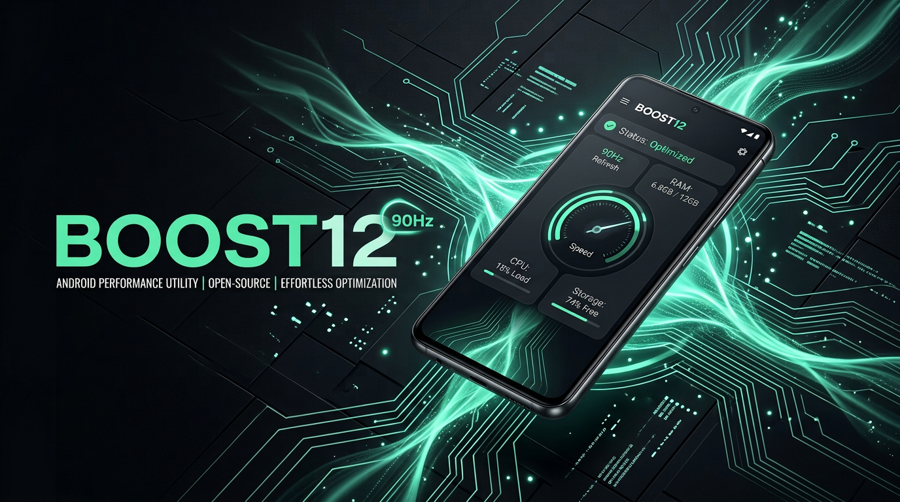
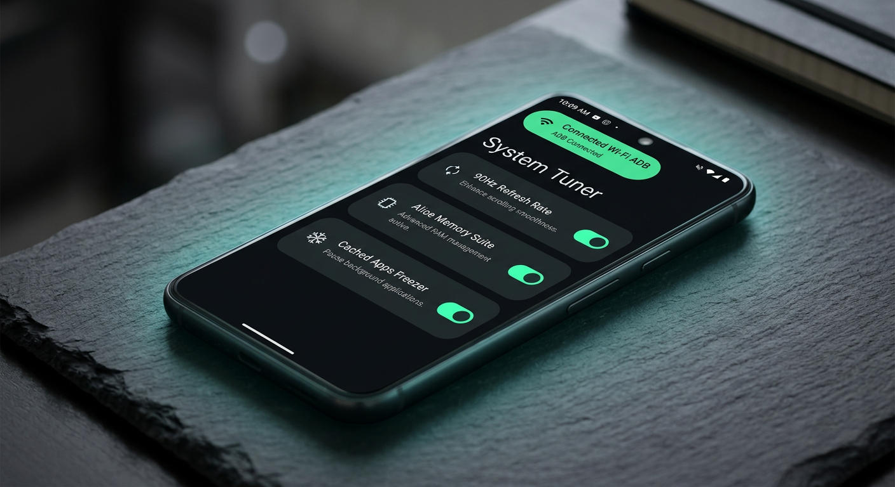

<div align="center">



# Boost12

**Self-Hosted On-Device Wireless ADB Performance & Memory Tuner for Xiaomi Redmi 12 4G**

[](https://github.com/Mamm00/Rd12/actions)
[](https://github.com/Mamm00/Rd12/releases/tag/v1.0)
[](https://kotlinlang.org)
[](https://developer.android.com/jetpack/compose)
[-3DDC84?style=flat-square&logo=android&logoColor=white)](app/build.gradle.kts)
[](#how-self-hosted-wireless-adb-works)

[**Download v1.0 Debug APK (Debugger Mode ON)**](https://github.com/Mamm00/Rd12/releases/download/v1.0/Boost12-v1.0-debug.apk) · [**Pairing Guide**](#quick-start-pairing-on-redmi-12-4g-no-pc-needed) · [**38-Card Command Matrix**](#audited-command-catalog-on--off--verify-matrix) · [**Architecture**](#clean-architecture--project-layout) · [**Changelog**](CHANGELOG.md)

</div>

---

## Overview

**Boost12** (`com.boost12.rd12`) is a modern, minimal, zero-root Android system tuning utility built from scratch in **100% Kotlin + Jetpack Compose (Material 3)** specifically for the **Xiaomi Redmi 12 4G** hardware family:

| Target Hardware Parameter | Redmi 12 4G Profile Tuned by Boost12 |
| :--- | :--- |
| **Model Family** | `22041219NY` / Redmi 12 4G (`sky` / `fire` MIUI & HyperOS) |
| **SoC & CPU** | Qualcomm **Snapdragon 685 (`SM6225`)** · 6 nm Kryo 265 (`4×2.8 GHz` Cortex-A73 + `4×1.9 GHz` Cortex-A53) |
| **GPU** | Qualcomm **Adreno 610** (Vulkan 1.1 / OpenGL ES 3.2 / ANGLE support) |
| **Memory & Storage** | **8 GB LPDDR4X RAM** · **256 GB Storage** (in-RAM zRAM + F2FS `fstrim` tuning) |
| **Display Panel** | **6.79" FHD+ 90 Hz AdaptiveSync** (`50 Hz / 60 Hz / 90 Hz` step states) |
| **OS Support** | **MIUI 14 & Xiaomi HyperOS** on **Android 13, 14, and 15** (`minSdk = 31`, `targetSdk = 35`) |

Unlike generic "RAM booster" apps that fake animations or require a PC/root setup, **Boost12 embeds a complete pure-Kotlin AOSP Wireless Debugging (`TLSv1.3` + `SPAKE2+`) client directly inside the APK**. It pairs with your phone's own `adbd` daemon over Wi-Fi, runs verified user-space shell commands (`settings`, `device_config`, `cmd`, `dumpsys`, `wm`, `pm`, `sm`), and **refuses to flip any switch unless a real-time `verifyShell` check proves the OS actually applied the change**.

---

## Minimal Material 3 Interface & Verified Toggles

<p align="center">
  
</p>

- **Dark-First Obsidian Aesthetic (`#0B0F14` + `#2EE59D` Electric Mint)**: Engineered for zero visual clutter — single-accent palette, `16dp` rounded card geometry, optional Android 12+ **Dynamic Color**, zero ads, and zero analytics trackers.
- **Single-Screen Control Deck**:
  - **Live Status Header**: Connection state chip (`Disconnected` / `Pairing` / `Connected` / `Error`) + real-time battery level & °C temperature parsed defensively from `dumpsys battery`.
  - **Hardware Profile Card**: Confirms live SoC, model, Android/HyperOS release, display refresh rate, and active verified boost count.
  - **Instant Search & Category Chips**: Filter across `All`, `CPU`, `GPU`, `RAM`, `Background`, `Display`, `Network`, and `Custom` — or search directly by `#Alice`, `90Hz`, `phantom`, `ram_expand_size`, `freezer`, or any shell flag.
  - **Honest Verification Switches**: Shimmer indicator while executing; turns **ON** or **OFF** *only* when `VerifyOutputParser` confirms expected output. If MIUI PowerKeeper or SELinux blocks a setting, the card displays a subtle inline banner (`"Didn't apply — tap to inspect raw output"`).
  - **Interactive Detail Bottom Sheet**: Plain-language explanation, copyable `ON` / `OFF` / `Verify` shell commands, expandable stdout/stderr console, **Test Run** button, per-card **Auto-revert on disconnect**, and **Revert** action.
- **Change History & 1-Tap Revert All**: Room-persisted chronological audit trail of every toggle applied, with a single-tap **Revert All** button that safely restores every active setting to stock.
- **Verbose ADB Debugger Mode (`ON` in v1.0 APK)**: Built-in protocol inspector in **Settings** streaming live mDNS resolution, SPAKE2+ handshake steps, `A_CNXN` / `A_STLS` / `A_OPEN` / `A_WRTE` frames, exit codes, and raw verification outputs.

---

## How Self-Hosted Wireless ADB Works

<p align="center">
  
</p>

1. **Local mDNS Auto-Discovery (`NsdManager`)**: Automatically listens for `_adb-tls-pairing._tcp` and `_adb-tls-connect._tcp` broadcasts restricted strictly to the device's own local network interfaces (with manual `IP:port` fallback when needed).
2. **Cryptographic 6-Digit Pairing (`SPAKE2+` over `TLSv1.3`)**:
   - Establishes an unauthenticated `TLSv1.3` socket and extracts 64 bytes of RFC 5705 Exported Keying Material (`"adb-label\0"`).
   - Executes BoringSSL-compatible **SPAKE2 over Edwards25519** (`Spake25519.kt`) using the 6-digit pairing code + EKM, derives a 128-bit `AES-128-GCM` key via `HKDF-SHA256`, and securely exchanges the 8192-byte AOSP `PeerInfo` structure containing Boost12's 2048-bit RSA public key.
3. **Encrypted Credential Persistence**: Stores the generated RSA-2048 private key, self-signed X.509v3 certificate, and last known connect endpoint inside **`EncryptedSharedPreferences`** (`AES256_SIV` + `AES256_GCM`) for instant one-tap reconnection across app restarts.
4. **Resilient Multiplexed `A_STLS` Transport**: Upgrades `A_CNXN → A_STLS` to mutually authenticated `TLSv1.3`, runs sequential shell streams (`shell,v2,raw:` / `shell:`), and automatically reconnects with **exponential backoff (`1s → 2s → 4s → 8s → 16s → 30s`)** if Doze or Wi-Fi roaming drops the socket.
5. **Hard Safety Gate (`CommandSafetyGuard`)**: Every built-in and custom command is tokenized across compound shell chains (`;`, `&&`, `||`, `|`, `$()`, `sh -c`) before reaching the socket — hard-blocking `rm`, `dd`, `mkfs`, `wipe`, `master_clear` / factory reset, `reboot recovery/bootloader/edl`, `pm uninstall`, `su`/`magisk`, and writes to `/system`, `/vendor`, `/data/system`, or `/proc/sys`.

---

## Clean Architecture & Project Layout

```text
Rd12/
├── .github/workflows/android-ci.yml      # CI pipeline: Unit + Robolectric UI tests, Lint, APK v1.0 Release
├── docs/images/                          # Product banner, UI showcase & Wireless ADB architecture visuals
├── gradle/libs.versions.toml             # Centralized Gradle Version Catalog (AGP 8.7.3, Kotlin 2.1.10, Compose)
├── app/
│   ├── build.gradle.kts                  # SDK 31–35, Hilt, Room KSP, Conscrypt, BouncyCastle, Signing config
│   ├── proguard-rules.pro                # R8 keep rules for Room, Serialization, Conscrypt & BouncyCastle
│   └── src/
│       ├── main/java/com/boost12/rd12/
│       │   ├── data/
│       │   │   ├── adb/
│       │   │   │   ├── crypto/           # Spake25519, PairingAuthCipher, AndroidPubkeyCodec, AdbCredentialStore
│       │   │   │   ├── mdns/             # AdbMdnsDiscovery (_adb-tls-pairing._tcp & _adb-tls-connect._tcp)
│       │   │   │   ├── protocol/         # AdbProtocol, SslContextFactory, AdbPairingClient, AdbConnectionSession
│       │   │   │   ├── telemetry/        # Defensive DumpsysTelemetryParser (battery %, °C, Hz, thermal)
│       │   │   │   └── AdbRepositoryImpl.kt
│       │   │   ├── catalog/              # DefaultCommandCatalog (38 Redmi 12 4G & #Alice entries)
│       │   │   ├── local/                # Room Boost12Database, DAOs & Entities (states, custom cmds, history)
│       │   │   └── repository/           # CommandRepositoryImpl (cross-card preset sync & revert engine)
│       │   ├── di/                       # Hilt AppModule (@Singleton bindings)
│       │   ├── domain/
│       │   │   ├── engine/               # CommandEngine (timeouts, 1x retry, verify gate, auto-rollback)
│       │   │   ├── model/                # Command, VerifyRule, DeviceProfile, AdbConnectionState, Telemetry
│       │   │   ├── parser/               # Zero-crash VerifyOutputParser
│       │   │   ├── repository/           # AdbRepository & CommandRepository contracts
│       │   │   └── safety/               # CommandSafetyGuard destructive-command firewall
│       │   └── ui/
│       │       ├── components/           # TopStatusHeader, DeviceProfileCard, CommandCard, Sheets
│       │       ├── screens/              # MainScreen, HistoryScreen, SettingsScreen
│       │       ├── theme/                # Obsidian + Electric Mint (#2EE59D) Material 3 theme
│       │       └── Boost12ViewModel.kt   # Reactive MVVM state holder
│       ├── test/                         # 6 JVM & Robolectric Compose UI smoke test suites
│       └── androidTest/                  # AndroidX Compose instrumented test suite
├── CHANGELOG.md
└── keystore.properties.example
```

---

## Audited Command Catalog (ON / OFF / Verify Matrix)

Boost12 ships with **38 built-in cards** (**35 active shell-verified commands** + **3 honest root-unavailable disclosures**), plus an interactive **Custom ADB Shell** builder. Conflicting presets (such as `0.0x` vs `0.5x` animations, or `#Alice 512` vs `108096` cached processes) automatically re-verify sibling cards on toggle.

### Display, 90 Hz & Game Turbo
| ID | ON Command(s) | OFF Counterpart (Revert) | Real-Time Verify Rule |
| :--- | :--- | :--- | :--- |
| `anim_scale_zero` | `window` / `transition` / `animator` scales → `0.0` | All 3 scales → `1.0` | `AllScalesEqual(0.0f)` across all 3 `settings get global` lines |
| `anim_scale_half` | All 3 animation scales → `0.5` | All 3 scales → `1.0` | `AllScalesEqual(0.5f)` across all 3 `settings get global` lines |
| `display_force_90hz` | `user_refresh_rate 90`, `miui_refresh_rate 90`, `min/peak_refresh_rate 90.0` | `user/miui_refresh_rate 60`, `min_refresh_rate 60.0`, `peak 90.0` | `RefreshRateHzRule(90)` across Xiaomi & AOSP keys |
| `display_miui_power_mode` | `settings put system power_mode high` | `settings put system power_mode middle` | `settings get system power_mode` == `high` |
| `display_miui_game_turbo` | `gb_boosting 1`, `perf_shielder_GESTURE_OPT 1` | `gb_boosting 0`, `perf_shielder_GESTURE_OPT 0` | `settings get secure gb_boosting` == `1` |
| `display_per_app_game_90hz` | `cmd game mode performance <pkg>`, `speed_mode 1` | `cmd game mode standard <pkg>`, `speed_mode 0` | `settings get secure speed_mode` == `1` |
| `display_wm_density_440` | `wm density 440` | `wm density reset` | `wm density` matches `Override density: 440` vs stock physical |

### CPU & Adreno 610 GPU
| ID | ON Command(s) | OFF Counterpart (Revert) | Real-Time Verify Rule |
| :--- | :--- | :--- | :--- |
| `cpu_fixed_performance_mode` | `cmd power set-fixed-performance-mode-enabled true` | `cmd power set-fixed-performance-mode-enabled false` | `dumpsys power` `mFixedPerformanceModeEnabled=true` |
| `cpu_disable_adaptive_power_saver` | `cmd power set-adaptive-power-saver-enabled false`, `low_power 0` | `cmd power set-adaptive-power-saver-enabled true` | `dumpsys power` `mAdaptivePowerSaverEnabled=false` |
| `cpu_relax_background_cpu_quota` | `power_check_max_cpu_1/2` → `75` | `settings delete global power_check_max_cpu_1/2` | `settings get global power_check_max_cpu_1` == `75` |
| `gpu_angle_vulkan_driver` | `settings put global angle_gl_driver_all_angle 1` | `settings put global angle_gl_driver_all_angle 0` | `settings get global angle_gl_driver_all_angle` == `1` |
| `gpu_disable_hw_overlays` | `settings put global disable_hw_overlays 1` | `settings put global disable_hw_overlays 0` | `settings get global disable_hw_overlays` == `1` |
| `gpu_skiavk_hwui_hint` | `setprop debug.hwui.renderer skiavk` | `setprop debug.hwui.renderer opengl` | `getprop debug.hwui.renderer` == `skiavk` (auto-reverts if blocked) |

### `#Alice` Suite, RAM & Storage / IO
| ID | ON Command(s) | OFF Counterpart (Revert) | Real-Time Verify Rule |
| :--- | :--- | :--- | :--- |
| `alice_full_profile_bundle` | Runs all 7 `#Alice` `device_config` & phantom-process commands | Resets all 7 `#Alice` `device_config` & `settings` overrides | Compound `device_config` + `settings` check across all 7 keys |
| `alice_lock_device_config_sync` | `device_config set_sync_disabled_for_tests persistent` | `device_config set_sync_disabled_for_tests none` | `device_config get_sync_disabled_for_tests` == `persistent` |
| `alice_device_config_max_cached_512` | `device_config put activity_manager max_cached_processes 512` | `device_config delete activity_manager max_cached_processes` | `device_config get activity_manager max_cached_processes` == `512` |
| `ram_device_config_max_cached_108096` | `device_config put activity_manager max_cached_processes 108096` | `device_config delete activity_manager max_cached_processes` | `device_config get activity_manager max_cached_processes` == `108096` |
| `alice_max_phantom_processes_unlimited` | `device_config put activity_manager max_phantom_processes 2147483647` | `device_config delete activity_manager max_phantom_processes` | `device_config get activity_manager max_phantom_processes` == `2147483647` |
| `alice_max_empty_time_12h` | `device_config put activity_manager max_empty_time_millis 43200000` | `device_config delete activity_manager max_empty_time_millis` | `device_config get activity_manager max_empty_time_millis` == `43200000` |
| `alice_enable_memory_compaction` | `device_config put activity_manager use_compaction true` | `device_config delete activity_manager use_compaction` | `device_config get activity_manager use_compaction` == `true` |
| `ram_disable_miui_ram_expand` | `settings put global ram_expand_size 0` | `settings delete global ram_expand_size` | `settings get global ram_expand_size` == `0` |
| `ram_enable_zram_global` | `settings put global zram_enabled 1` | `settings delete global zram_enabled` | `settings get global zram_enabled` == `1` |
| `ram_max_cached_processes_16` | `activity_manager_constants max_cached_processes=16` | `settings delete global activity_manager_constants` | `settings get global activity_manager_constants` matches `16` |
| `ram_kill_cached_and_fstrim` | `fstrim_mandatory_interval 1`, `cmd activity kill-all`, `sm fstrim` | `settings delete global fstrim_mandatory_interval` | `settings get global fstrim_mandatory_interval` == `1` |
| `storage_trim_caches_and_logs` | `pm trim-caches 1024M`, `dropbox_max_files 128`, `sys_storage_cache_max_bytes` | `settings delete global dropbox_max_files` & cache cap | `settings get global dropbox_max_files` == `128` |
| `storage_lift_app_standby_bucket` | `am set-standby-bucket <pkg> active` | `am set-standby-bucket <pkg> working_set` | `am get-standby-bucket <pkg>` == `10` (`ACTIVE`) |

### Background Process Control & Network
| ID | ON Command(s) | OFF Counterpart (Revert) | Real-Time Verify Rule |
| :--- | :--- | :--- | :--- |
| `bg_cached_apps_freezer_enabled` | `settings put global cached_apps_freezer enabled` | `settings delete global cached_apps_freezer` | `settings get global cached_apps_freezer` == `enabled` |
| `alice_native_boot_use_freezer` | `device_config put activity_manager_native_boot use_freezer true` | `device_config delete activity_manager_native_boot use_freezer` | `device_config get activity_manager_native_boot use_freezer` == `true` |
| `alice_disable_phantom_proc_monitor` | `settings put global settings_enable_monitor_phantom_procs false` | `settings put global settings_enable_monitor_phantom_procs true` | `settings get global settings_enable_monitor_phantom_procs` == `false` |
| `bg_app_standby_enabled` | `settings put global app_standby_enabled 1` | `settings delete global app_standby_enabled` | `settings get global app_standby_enabled` == `1` |
| `bg_app_restriction_enabled` | `settings put global app_restriction_enabled true` | `settings delete global app_restriction_enabled` | `settings get global app_restriction_enabled` == `true` |
| `bg_process_limit_4` | `settings put global background_process_limit 4` | `settings delete global background_process_limit` | `settings get global background_process_limit` == `4` |
| `bg_disable_intelligent_sleep_mode` | `settings put system intelligent_sleep_mode 0` | `settings delete system intelligent_sleep_mode` | `settings get system intelligent_sleep_mode` == `0` |
| `bg_deep_doze_acceleration` | `device_idle_constants inactive_to=60000,...` | `settings delete global device_idle_constants` | `settings get global device_idle_constants` contains `inactive_to=60000` |
| `bg_freeze_target_package` | `deviceidle whitelist -<pkg>`, `appops RUN_IN_BACKGROUND ignore` | `appops RUN_IN_BACKGROUND allow` & `RUN_ANY_IN_BACKGROUND allow` | `cmd appops get <pkg> RUN_IN_BACKGROUND` matches `ignore` |
| `net_restrict_background_global` | `cmd netpolicy set restrict-background true` | `cmd netpolicy set restrict-background false` | `cmd netpolicy get restrict-background` matches `enabled`/`true` |
| `net_wifi_low_latency_scan_off` | `wifi_scan_always_enabled 0`, `wifi_wakeup_enabled 0`, `ble_scan_always_enabled 0` | `wifi_scan_always_enabled 1`, `wifi_wakeup_enabled 1` | `settings get global wifi_scan_always_enabled` == `0` |
| `net_per_app_background_blacklist` | `cmd netpolicy add restrict-background-blacklist <uid>` | `cmd netpolicy remove restrict-background-blacklist <uid>` | `cmd netpolicy list restrict-background-blacklist` contains `<uid>` |

---

## Honest Root Limitations on Snapdragon 685 / HyperOS

Boost12 **never fakes toggle success**. Kernel/vendor parameters inaccessible to `adb shell` (`UID 2000`) are explicitly greyed out as **`Unavailable on this device`** with transparent tooltips:

1. **CPU `cpufreq` Scaling Governors & `mi_thermald` (`cpu_root_governor_thermal_locked`)**: `/sys/devices/system/cpu/cpufreq/policy*/scaling_governor` and `/vendor/etc/thermal-engine.conf` are owned by `root:system` under SELinux enforcement.
2. **Adreno 610 KGSL GPU Clock Floors (`gpu_adreno610_kgsl_locked`)**: `/sys/class/kgsl/kgsl-3d0/devfreq/*` nodes require `UID 0` root privileges.
3. **Raw Kernel `/sys/block/zram0/disksize` & `vm.swappiness` (`ram_zram_swappiness_locked`)**: Resizing raw kernel zRAM block geometry or `/proc/sys/vm/swappiness` requires `CAP_SYS_ADMIN` (use `ram_disable_miui_ram_expand` and `ram_enable_zram_global` for user-space swap/zRAM control).
4. **F2FS Kernel Discard Counters & Xiaomi Security Center SQLite DB**: Kernel `dmesg` F2FS byte counters (`dmesg_restrict=1`) and `/data/data/com.miui.securitycenter` Autostart tables are root-restricted; Boost12 verifies persistent user-space keys (`fstrim_mandatory_interval`, `appops`) and provides direct HyperOS Autostart instructions in-app.

---

## Quick Start: Pairing on Redmi 12 4G (No PC Needed)

1. Install [**`Boost12-v1.0-debug.apk`**](https://github.com/Mamm00/Rd12/releases/download/v1.0/Boost12-v1.0-debug.apk) on your Redmi 12 4G and connect to any Wi-Fi network.
2. Unlock **Developer Options** (*Settings → About phone → tap MIUI / HyperOS version 7 times*).
3. Inside *Settings → Additional settings → Developer options*, enable all three switches:
   - **USB debugging**
   - **USB debugging (Security settings)** *(mandatory on Xiaomi MIUI / HyperOS so `adb shell` is permitted to write `settings`, `device_config`, `wm`, and `appops`)*
   - **Wireless debugging**
4. Open **Boost12**, tap **Pair Wireless Debugging**, and place **Developer Options → Wireless debugging** in **Split-Screen** (so MIUI keeps the pairing dialog open).
5. Tap **Pair device with pairing code** — Boost12 automatically detects the pairing port via mDNS; enter the **6-digit code** and tap **Pair with SPAKE2+**.
6. Tap the in-app **Whitelist App** button and set Boost12's MIUI Battery Saver policy to **No restrictions** so HyperOS never kills your background ADB session.

---

## Building & Testing from Source

### Prerequisites
- **JDK 17** (Eclipse Temurin 17 recommended)
- **Android Studio Ladybug / Meerkat** or Android SDK (`platforms;android-35`, `build-tools;35.0.0`)

```bash
# Clone the repository
git clone https://github.com/Mamm00/Rd12.git
cd Rd12

# Run all JUnit4 unit tests + Robolectric Compose UI smoke tests + Android Lint
./gradlew testDebugUnitTest lintDebug

# Assemble Debug APK (v1.0, isDebuggable = true, Verbose ADB Debugger Mode ON)
./gradlew assembleDebug
# Output: app/build/outputs/apk/debug/app-debug.apk

# Assemble Release APK (uses keystore.properties if configured, or debug signing fallback)
cp keystore.properties.example keystore.properties
./gradlew assembleRelease
```

---

<div align="center">
  <sub>Built with Kotlin, Jetpack Compose Material 3, Hilt, Room & Pure-Kotlin AOSP TLSv1.3 Wireless ADB for the Redmi 12 4G community.</sub>
</div>
